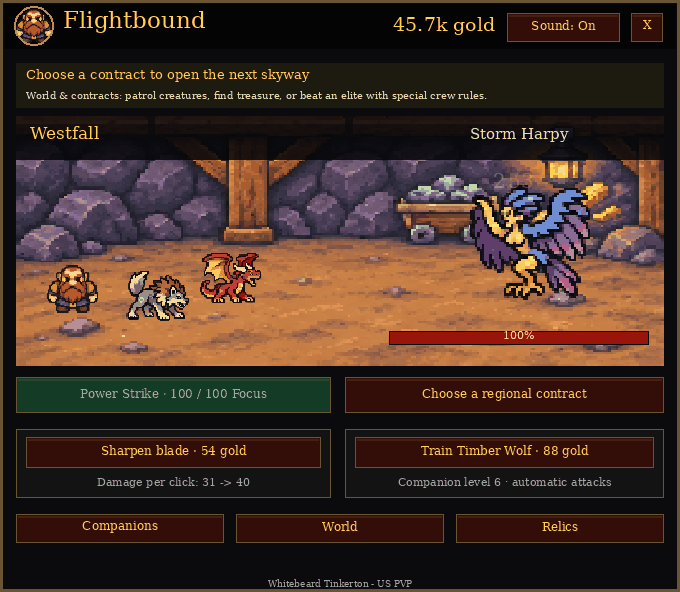

# Flightbound

An animated **WoW Forever idle clicker** for flight paths and short breaks.
Click creatures, collect gold, recruit a party and restore Azeroth's skyways.
Open it with **`/fb`**. Sound is on by default.

**Whitebeard Tinkerton - US PVP**

[Download the latest release](https://github.com/TLT26-churn/Flightbound/releases/latest)
 · [Game guide](Flightbound/README.md)
 · [Research and design](docs/redesign/research.md)



The preview is rendered from actual addon Lua draw calls and original assets with
a synthetic save. The GIF has no audio; the addon plays attack, loot and upgrade
sounds using WoW's Master sound channel.

## A clearer game

The adventure screen shows one objective, a large clickable creature, Power Strike
and two useful upgrade choices. Companions, World and Relics open separate screens
with a Back button. There is no resource-assignment dashboard to learn first.

- Animated creature breathing, companion lunges and projectiles, four-frame impact
  effects, enemy recoil, floating damage, defeat fades and gold flying to the counter.
- Six companion roles, three active slots, and visible evolutions at levels 10/25.
- Nine regions with bosses that use armor, wards, regeneration, elemental
  resistance, frost or swarms. Crew choices and active skills counter them.
- Twenty-seven regional contracts. Elite trials ask for different plans: a required
  companion, a lone ally, no manual attacks, or no Power Strike.
- Four play styles and six collectible relics with limited equipment slots.
- Crew progress while hidden or offline, up to eight hours per absence. Boss
  attempts pause while away or in management screens; offline credit never clears
  a new boss for you.

A guardian and one regional contract open each next skyway. The final Sky Citadel
requires 18 contracts. After the story, the journal still tracks unfinished
contracts, elite trials, relics and companion forms. This is a finite game, with
no forced prestige reset or infinite arena ladder.

## Install

**WoW Forever interface 16001**, on **Windows** or **Linux through Wine/Proton**.
One portable ZIP works on both; no external runtime is required inside WoW.

1. Download `Flightbound-5.0.0.zip` from Releases.
2. Extract its single `Flightbound` folder into `_forever_/Interface/AddOns/`.
3. Remove a previously installed `FlightboundCamp` prototype folder to avoid loading
   both games. Keep its SavedVariables if you want to preserve that experiment.
4. Restart WoW to discover the addon folder, enable Flightbound, and type `/fb`.

Version 5 starts a new idle adventure. It does not import the old RPG campaign or
the camp prototype. The old RPG SavedVariables remain declared and untouched;
new progress uses `FlightboundIdleDB`, with a separate backup variable. WoW writes
progress on clean logout/reload. No character movement, combat, spell, targeting,
flight-control or chat automation is performed.

## Development

```sh
luajit tests/idle-game.lua
luajit tests/idle-simulate.lua
luajit tests/idle-ui.lua
python3 tests/render_idle.py
python3 tools/package.py
```

Tests run on synthetic saves and a strict WoW UI stand-in. They cover fresh starts,
save isolation, live rules, offline batching, boss counterplay, all elite trials,
controls, sound/mute, real animation movement and bounded UI allocation. Rendering
checks frame bounds and text layout. Simulation policies include active, saturated
clicking and crew-led play. These are headless checks, not a claim of live client
playtesting or independent testing on both operating systems.

Artwork and sounds are reused from Flightbound's original generated assets.
Unofficial fan addon, not affiliated with Blizzard Entertainment.
