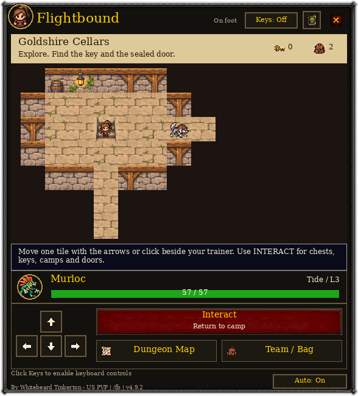
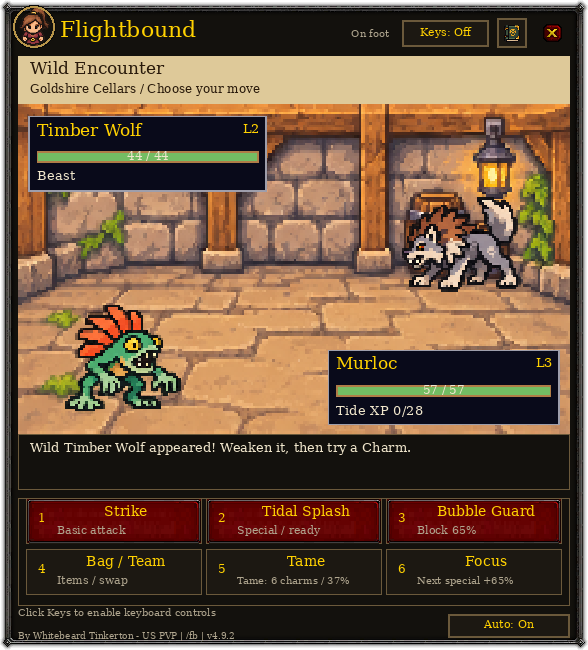

# Flightbound

A small, movable, Game Boy-style creature RPG inside **World of Warcraft: Forever**.
Explore hand-built dungeons, tame a team, and battle through an Azeroth-themed campaign
while you travel. Open it anytime with `/fb`, or let it open automatically on flight paths.

**By Whitebeard Tinkerton - US PVP**

[Download the latest release](https://github.com/TLT26-churn/Flightbound/releases/latest)
 · [Full game guide](Flightbound/README.md)
 · [Release notes](CHANGELOG.md)

| Explore | Battle |
| --- | --- |
|  |  |

Screenshots are rendered from the addon's actual UI and bundled assets using an isolated demo save.

## Play

- Eight themed dungeons with fog of war, keys, chests, secret passages and guardians, followed by the Sky Citadel finale.
- Twelve creature lineages, with evolutions at levels 6 and 14, custom names, colored sprites, animated specials and chiptune sound.
- A customizable trainer, Story/Adventure/Veteran difficulty, quests, upgrades and persistent exploration.
- Optional keyboard controls: arrows move, Space interacts, and number keys select battle moves. Escape releases keyboard focus.
- Friendly duels using teams of 1–3 owned species, normalized to level 14. Duels preserve campaign health, items and progress.
- Campaign leaderboards restricted to current friends and/or guildmates, with online sync and cached offline scores.

## Install

Works with **WoW Forever (interface 16001)** on **Windows** and **Linux through Wine/Proton**.
The same ZIP works on both; no external runtime or addon dependency is required.

1. Download `Flightbound-4.8.2.zip` from [Releases](https://github.com/TLT26-churn/Flightbound/releases).
2. Extract its `Flightbound` folder into your WoW installation's `_forever_/Interface/AddOns/` directory.
3. Check that `Interface/AddOns/Flightbound/Flightbound.toc` exists, without an extra nested folder.
4. For a first install, restart WoW and enable Flightbound in the AddOns list. For an update, replace the addon folder and `/reload`.
5. Type `/fb`.

Use the release ZIP for installation. GitHub's automatic **Source code** download contains the development repository and extra folders.
Updating 4.8.x preserves your campaign. WoW saves progress during `/reload` or clean logout.

## Friends, guildmates and duels

Both players need the same addon version and must be friends with each other or share a guild.
Open `/fb friends`, choose teams of the same size, then invite. Only online contacts detected
running Flightbound appear. The recipient gets an **Accept Duel / Choose Team / Decline** popup,
even with the game window closed; it never takes keyboard focus. Finish any active campaign
battle before starting. Battle.net friends count when their Forever character is known.

`/fb leaderboard` opens the campaign board. It ranks completion and campaign milestones, with
separate difficulty boards. Records are self-reported, intended for friendly comparison. There
is no public/global leaderboard or relay of strangers' records. `/fb sync off` pauses sharing.

**4.8.2 fixes discovery chat spam:** guild discovery uses a hidden guild-channel hello instead
of scanning the roster with whispers. Unreachable friends pause for five minutes; errors from
recent Flightbound background sends are filtered while ordinary whisper errors stay visible.
Invites now have an obvious popup, countdown and optional sound. Both players should update.

**4.8.1 fixes Forever compatibility:** it uses first name + surname, does not mistake a surname
for a realm, and no longer treats Forever's outgoing-chat flag as a blanket addon-whisper block.
Actual chat lockdown and send failures are still respected.

If linking is unavailable, `/fb linkstatus` shows the setup/send status. `/fb linktest` sends
one addon whisper to your own character and reports whether it returns. It does not message contacts.
Self-whisper delivery has been verified live on US PvP. Friend-to-friend duels and synchronization
have passed simulated two-client tests; a live two-player session remains to be verified.

## Develop and test

Runtime code and assets are in `Flightbound/`; the game rules and peer protocol are testable without WoW.
The headless tests use synthetic saves and simulated APIs, never the installed game's files.

On Linux, install LuaJIT, Python 3 and Pillow, then run from the repository root:

```sh
luajit tests/flightbound-game.lua
luajit tests/flightbound-critical.lua
luajit tests/flightbound-social.lua
luajit tests/flightbound-social-client.lua
luajit tests/flightbound-ui.lua --animation
python3 tests/render_flightbound.py --check-layer-order --animation
python3 tools/package.py
```

The renderer checks 263 screens for text overflow and drawing order. Other checks cover campaign
completion, combat rules, keyboard focus, friend/guild admission, lost and duplicated packets,
reload recovery, long turn histories and campaign isolation. These tests complement live-client testing.
The packaging command creates `dist/Flightbound-<version>.zip` containing only the portable addon folder.

The bundled Silkscreen font includes its [SIL Open Font License](Flightbound/Art/Silkscreen-OFL.txt).
Artwork is generated pixel art; previews use the bundled assets. This is an unofficial fan addon.
